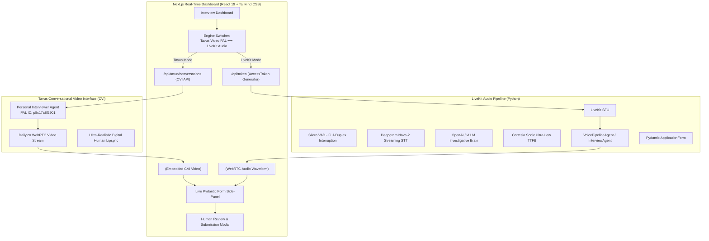

# Personal Technical Interviewer: Tavus Digital Human & LiveKit Voice Dashboard

A full-stack, real-time technical interviewer dashboard supporting both **Tavus Conversational Video Interface (CVI) Digital Human PAL** and **LiveKit SFU Low-Latency Audio**. The system conducts an investigative screening interview with intelligent probing behavior (pushing back on vague "we" claims and demanding quantifiable metrics), displays live Pydantic state synchronization on a side panel, and presents a human review modal for draft editing and approval.

---

## 🚀 Dual-Engine Architecture



- **Tavus Digital Human (Video CVI)**: Powered by **PAL ID: `p8c17a8f2901`** ("Personal Interviewer Agent"), delivering a face-to-face conversational digital human with dynamic expressions and lip-sync.
- **LiveKit Pipeline (Audio SFU)**: Silero VAD barge-in (`allow_interruptions=True`), Deepgram Nova-2 streaming STT, Cartesia Sonic ultra-low TTFB TTS, and OpenAI/vLLM backend.
- **Pydantic State Validation**: Target fields (`project_name`, `personal_ownership`, `impact_metrics`, `ready_for_review`) strictly requiring first-person ownership and quantifiable numbers.
- **Real-Time Human Review**: Interactive side-panel, inline transcript editor, JSON inspection, and formal approval workflow.

---

## 📁 Repository Structure

```
Griffin-R/
├── app/
│   ├── api/
│   │   ├── tavus/
│   │   │   └── conversations/
│   │   │       ├── route.ts            # Tavus conversation creation (POST /api/tavus/conversations)
│   │   │       └── [id]/end/route.ts   # Tavus conversation end (POST /api/tavus/conversations/:id/end)
│   │   └── token/
│   │       └── route.ts                # LiveKit AccessToken generator
│   ├── globals.css                     # Tailwind CSS & modal overscroll containment
│   ├── layout.tsx                      # Root HTML layout with dark theme
│   └── page.tsx                        # Dual-engine interview dashboard (Tavus Video & LiveKit Audio)
├── components/
│   ├── TavusRoom.tsx                   # Embedded Tavus CVI video player, controls & status
│   ├── InterviewRoom.tsx               # LiveKitRoom wrapper, visualizer, audio controls
│   ├── FormPreview.tsx                 # Live-updating Pydantic form side-panel
│   ├── ReviewModal.tsx                 # Human review, transcript editor & submission flow
│   └── types.ts                        # ApplicationFormState TypeScript interface
├── lib/
│   └── utils.ts                        # Tailwind merge helper
├── .env.sample                         # Backend environment template
├── .env.local                          # Frontend environment configuration (Tavus & LiveKit)
├── agent.py                            # VoicePipelineAgent, LiveKit worker & tools
├── schema.py                           # Pydantic form state model & validation logic
├── test_interviewer.py                 # Automated verification tests & mock turn harness
├── requirements.txt                    # Python dependencies
├── package.json                        # Frontend dependencies & scripts
├── tsconfig.json                       # TypeScript configuration
├── tailwind.config.ts                  # Tailwind styling configuration
└── README.md                           # System documentation
```

---

## ⚙️ Quick Start

### 1. Configure Environment Variables

Copy the sample file and fill in your credentials.
> **`.env.local` is gitignored — never commit it.**

```powershell
Copy-Item .env.sample .env.local
```

Required keys for Tavus & LiveKit:
```bash
# Tavus CVI (Conversational Video Interface)
TAVUS_API_KEY=your_tavus_api_key          # Create at https://maker.tavus.io/dev/api-keys
NEXT_PUBLIC_TAVUS_PAL_ID=p8c17a8f2901    # Personal Interviewer Agent PAL ID

# LiveKit SFU (for Audio Mode)
NEXT_PUBLIC_LIVEKIT_URL=wss://your-livekit-instance.livekit.cloud
LIVEKIT_API_KEY=your_livekit_api_key
LIVEKIT_API_SECRET=your_livekit_api_secret

# Python Voice Stack (for agent.py)
DEEPGRAM_API_KEY=your_deepgram_api_key
CARTESIA_API_KEY=your_cartesia_api_key
OPENAI_API_KEY=your_openai_api_key
```

### 2. Start the Frontend Dashboard
```powershell
npm install
npm run dev
```
Open [http://localhost:3000](http://localhost:3000) in your browser.

---

## 🎙️ Choosing Your Interview Experience

### Option A: Tavus Digital Human Video Interview (Recommended)
1. In the top navbar, select **"Tavus Video PAL"**.
2. Verify the PAL ID is set to `p8c17a8f2901`.
3. Click **"Start Tavus Video Interview"** to launch the embedded Conversational Video Interface.
4. *Direct Link Fallback:* You can also paste any Tavus Hosted Link (`https://tavus.daily.co/c...`) directly into the "Direct Hosted Link / Custom Embed URL" field to launch instantly!

### Option B: LiveKit Low-Latency Audio Interview
1. In the top navbar, select **"LiveKit Audio"**.
2. Start the Python voice worker:
   ```powershell
   .venv\Scripts\python.exe agent.py dev
   ```
3. Click **"Start LiveKit Audio Interview"** to connect with real-time audio wave visualizers and barge-in support.

---

## 🧪 Testing & Verification

### Run Python Verification Suite
```powershell
.venv\Scripts\python.exe test_interviewer.py
```
*Passes all 10 unit and simulation tests in <0.01s.*

### Build Next.js Production Bundle
```powershell
npm run build
```
*Builds with zero TypeScript, lint, or webpack errors.*

---

## 📄 Output Artifact: Structured Pydantic JSON Draft
```json
{
  "project_name": "High-throughput Event Streaming Gateway",
  "personal_ownership": "I personally architected the memory-mapped ring buffer and wrote the zero-copy deserializer in Rust.",
  "impact_metrics": "It handled 120,000 events per second with sub-5ms p99 latency and zero packet loss.",
  "ready_for_review": true
}
```
